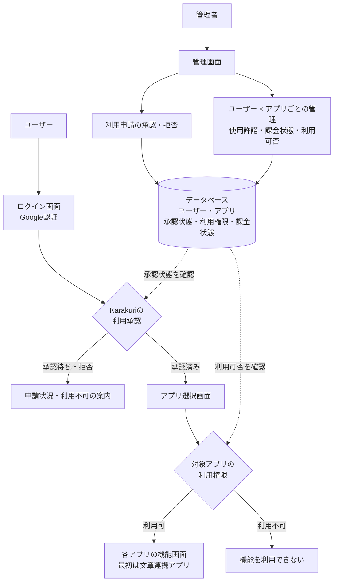

# Karakuri 基本構成設計

- 作成日: 2026-10-30
- 状態: 要件整理段階の論理構成。アプリ未実装、技術方式・実機動作は未検証。
- 要件正本: [要件定義](requirements.md) 第2.2〜2.4節
- 対応要件: FR-005〜FR-009、FR-014〜FR-016（受入基準A05〜A07、A11〜A14）

## 画面遷移と管理の関係

通常の利用経路は「ログイン画面 → アプリ選択画面 → 選択したアプリの機能画面」。全体の利用承認とアプリ単位の利用権限をそれぞれ確認する。

図は画面・役割・データの論理的な関係を示す。ブラウザからDBへ直接接続する設計を示すものではない。認証・承認・権限はサーバー側でも検証し、機能画面への直接アクセス、API、リアルタイム接続にも適用する。管理画面と管理操作は管理者のみが利用できる。

## 管理者の役割と管理単位

- Karakuri全体の利用申請を承認・拒否する。
- ユーザーごとに各アプリの使用を許可・取り消しする。
- ユーザー・アプリごとに「課金した／しない」を管理し、対象アプリの利用可否へ反映する。
- 上記の状態をDBに保存する。ある組み合わせの変更は、他のユーザー・アプリの利用権限へ影響させない。

以下は管理単位を示す例であり、実データや課金ルールの確定を意味しない。

| ユーザー | アプリ | 使用許諾 | 課金状態 | 利用可否 |
| --- | --- | --- | --- | --- |
| ユーザーA | 文章連携 | 許可 | 課金した | 利用可 |
| ユーザーA | 将来のアプリB | 未許可 | 課金しない | 利用不可 |
| ユーザーB | 文章連携 | 許可 | 課金した | 利用可 |

## 未決事項と設計の範囲

- 権限のないアプリを選択画面に表示するか。
- 初回承認時のアプリ権限付与方法、取消の既存接続への反映タイミング、変更履歴の保持。
- 「課金した」が請求・入金のどの時点を意味するか、料金・契約・有効期間、無料利用・免除の扱い。単純な課金必須ルールは確定していない。
- 決済サービス連携、自動請求・自動入金確認は今回のMVP対象外。
- DB製品・スキーマ、ホスティング、認証の実装方式などの技術構成は未決。

未決事項の正本は [要件定義 第8節](requirements.md#8-実装前に決める事項)。今後の詳細設計・実装taskでは対象要件IDと検証方法を引き継ぐ。本書の保存は実装開始を意味しない。
