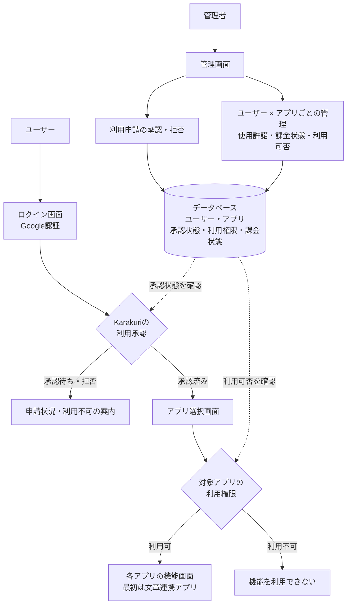

# Karakuri 基本構成設計

- 作成日: 2026-10-30
- 状態: 基本構成と共通基盤の実装設計。task0004で認証・管理基盤を実装中。Google実認証・実機動作は未検証。
- 要件正本: [要件定義](requirements.md) 第2.2〜2.4節
- 対応要件: FR-005〜FR-009、FR-014〜FR-016（受入基準A05〜A07、A11〜A14）

## 画面遷移と管理の関係

通常の利用経路は「ログイン画面 → アプリ選択画面 → 選択したアプリの機能画面」。全体の利用承認とアプリ単位の利用権限をそれぞれ確認する。

図は画面・役割・データの論理的な関係を示す。ブラウザからDBへ直接接続する設計を示すものではない。認証・承認・権限はサーバー側でも検証し、機能画面への直接アクセス、API、リアルタイム接続にも適用する。管理画面と管理操作は管理者のみが利用できる。

## 管理者の役割と管理単位

- Karakuri全体の利用申請を承認・拒否する。
- ユーザーごとに各アプリの使用を許可・取り消しする。
- ユーザー・アプリごとに「課金した／しない」を管理し、対象アプリの利用可否へ反映する。
- 上記の状態をDBに保存する。ある組み合わせの変更は、他のユーザー・アプリの利用権限へ影響させない。

以下は管理単位を示す例であり、実データや課金ルールの確定を意味しない。

| ユーザー | アプリ | 使用許諾 | 課金状態 | 利用可否 |
| --- | --- | --- | --- | --- |
| ユーザーA | 文章連携 | 許可 | 課金した | 利用可 |
| ユーザーA | 将来のアプリB | 未許可 | 課金しない | 利用不可 |
| ユーザーB | 文章連携 | 許可 | 課金した | 利用可 |

## 未決事項と設計の範囲

- task0004では権限のないアプリも表示し、利用不可を案内する方式を採用。
- 初回全体承認でアプリ権限は自動付与しない。取消は次のリクエストから反映し、長時間接続への反映方式と変更履歴の保持期間は未決。
- 「課金した」が請求・入金のどの時点を意味するか、料金・契約・有効期間、無料利用・免除の扱い。単純な課金必須ルールは確定していない。
- 決済サービス連携、自動請求・自動入金確認は今回のMVP対象外。
- DBはSQLiteで初期運用しPostgreSQL・MySQLへも切り替え可能、認証はdjango-allauthのGoogleプロバイダーを採用。データモデルは後掲。ホスティング・本番運用構成は未決。

未決事項の正本は [要件定義 第8節](requirements.md#8-実装前に決める事項)。今後の詳細設計・実装taskでは対象要件IDと検証方法を引き継ぐ。本書の保存は実装開始を意味しない。

## task0004 共通基盤の実装設計

Python＋Django 5.2 LTSを採用し、画面とサーバー処理を単一Djangoプロジェクトで提供する。Google OAuthはdjango-allauth、管理UIは専用AdminSite、DBはSQLite（PostgreSQL・MySQLへ切り替え可能）、画面はDjango Templatesを使用する。セットアップと外部設定は [開発ガイド](development.md) を参照する。

### データ

| モデル | 内容 |
| --- | --- |
| User | DjangoのカスタムUser。全体申請状態pending/approved/rejectedとis_staffを分離する |
| SocialAccount | allauthが管理するGoogle識別子とUserの対応。メール一致だけで別IDを自動紐付けしない |
| App | アプリ台帳。文章連携の入口をマイグレーションで登録する |
| AppAccess | User×Appで一意。allowed（利用許可）とcharged（課金した）を独立して保存する |
| AuditEvent | 管理操作の操作者・対象・日時・変更前後を記録する。Webでの編集・削除を禁止する |
| Session | DjangoのDBセッション。Google認証済み情報とログイン成立から14日の絶対期限を保存する |

課金状態と利用許可を別項目にする方式はユーザー承認済み。無料で許可されたアプリも利用でき、課金済みでも許可がなければ利用できない。申請の全体承認だけでアプリ権限は増えない。

### 認証とアクセス制御

- Google認証後のみセッションへ認証済み情報と絶対期限を書き込む。利用・セッション更新で期限を延ばさない。ミドルウェアが証跡と期限を毎回確認する。
- ブラウザを閉じても14日の期限内は維持し、期限到達・ログアウト時は失効する。セッション証跡や期限が不正・欠落の場合も利用不可とする。
- パスワードログイン・登録・リセット・開発用ログインのURLは公開しない。管理画面もGoogle認証のみ。OAuth未設定時はログイン不可を表示し、OAuth経路は503を返す。
- OAuthのstateとPKCEはallauthに任せる。Google認証開始・ログアウト・管理変更にCSRF対策を適用し、未許可の外部リダイレクトを拒否する。
- 管理画面はactive・staff・全体承認済みを要求する。初期管理者はGoogle認証後に管理コマンドで指定する。Webから管理者フラグやGoogle紐付けは変更できない。
- アプリ画面/APIは認証・active・全体承認・対象アプリのallowedを共通検証する。未知のアプリや許可レコードがない場合は拒否する。権限・全体承認の取消は次のリクエストから反映する。
- 権限のないアプリも選択画面に表示し、利用不可を示す。申請通知は管理一覧に留め、拒否後の再申請は自動化しない。
- 管理変更と監査記録はDjango Adminのトランザクション内で保存する。監査の保持期間は未決で、自動削除は行わない。

task0004のアプリ入口と確認APIは基盤の確認用であり、文章を扱わない。文章の所有者分離・受信接続への権限反映・接続中の期限失効は後続taskで実装・検証する。

### DBバックエンドの切り替え

`DB_BACKEND=sqlite`（既定）・`postgresql`・`mysql` を起動時に選択する。SQLiteの既定パスは `.data/db.sqlite3`。`SQLITE_PATH`で変更できる。不正な値・接続失敗を他DBへの自動切り替えで隠さない。設定は接続先だけを選ぶため、データ移行は別途バックアップ・移送・整合確認が必要。認証・権限・セッションのモデルと判定は共通に保つ。

MySQLはDjango標準バックエンドとmysqlclientを使い、utf8mb4・strict mode・InnoDBを指定する。MySQL 8.4で共通の認証・権限・JSON/Unicode・一意制約試験を行う。allauthの条件付き一意制約はMySQLでは作成されずW036が出る。現在のGoogle専用認証はUser.emailの一意制約とSocialAccountのprovider/uid一意制約、メール一致での自動紐付け禁止を使用する。メール管理経路等の拡張時は、EmailAddress側の制約差も再検討する。警告を抑制して同等と見なさない。
